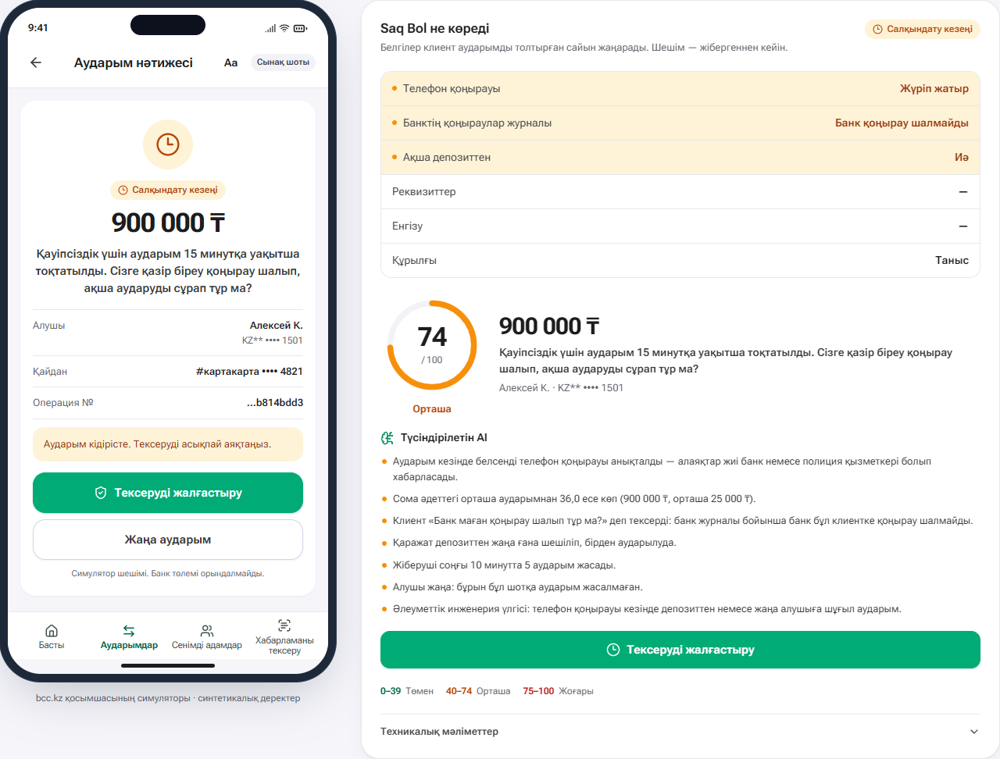

# Saq Bol × BCC

Bank CenterCredit кейсіне арналған тәуелсіз прототип · Независимый прототип для кейса Bank CenterCredit, ITU Hackathon 2026.

**Қазақша.** Біреу қоңырау шалып, клиенттен «қауіпсіз шотқа» 900 000 ₸ аударуды сұрайды. Saq Bol аударымды 15 минутқа кідіртеді және себебін түсіндіреді. Клиент алаяқтық туралы хабарлай алады. Банк қауіпсіздігі қызметкері сол аударымды тауып, клиентке кері қоңырау ұсынады.

**По-русски.** Звонящий просит клиента перевести 900 000 ₸ на «безопасный счёт». Saq Bol ставит перевод на паузу на 15 минут и объясняет причину. Клиент может сообщить об обмане. Сотрудник безопасности видит тот же перевод и предлагает клиенту созвониться.

**[Қазылар бөлмесін ашу / Открыть комнату жюри →](https://saq-bol-jury.onrender.com/)**

**Тарихымен ашу / Открыть с историей.** Жаңа бөлмеде осы түймені таңдасаңыз, 40 оқу аударымы мен 10 байланысты іс қосылады. Клиент басты беттен сақталған алушыны таңдап, соманы енгізген соң оның атын тексере алады.

На стартовой странице жюри нажмите **«Открыть с историей»**. Клиент увидит семь получателей и свои обращения, сотрудник SOC — десять связанных дел. Для проверки одного перевода с обеих сторон войдите в ту же комнату из второго профиля браузера. Этот набор можно запустить и локально на PostgreSQL. [Android Studio](docs/ANDROID_STUDIO_HANDOFF_RU.md) · [Оқу деректері / Учебные данные](docs/DEMO_DATA_RU.md)

## Қазыларға арналған оқу тіркелгілері / Учебные аккаунты для жюри

Бастапқы беттен **«Үш рөлге кіру»** бөлімін ашыңыз немесе төмендегі кестені қолданыңыз. **«Бөлме ашу»** түймесін басыңыз, қажет рөлдің логині мен құпиясөзін енгізіп, **«Кіру»** түймесін басыңыз. Бөлмеде тек оқу ақшасы қолданылады.

На стартовой странице раскройте **«Вход под тремя ролями»** или возьмите данные из таблицы. Нажмите **«Открыть комнату»**, введите логин и пароль нужного аккаунта и нажмите **«Войти»**. Все операции в комнате учебные.

| Рөл / Роль | Логин | Құпиясөз / Пароль |
| --- | --- | --- |
| Клиент | `client_demo` | `SaqBol-Client-2026` |
| SOC қызметкері / Сотрудник SOC | `admin_demo` | `SaqBol-Officer-2026` |
| Платформа әкімшісі / Администратор платформы | `platform_demo` | `SaqBol-Platform-2026` |

Бір істі екі рөлде көру үшін бөлменің сілтемесін бастапқы беттен көшіріп, браузердің басқа профилінде ашыңыз. Бөлме 30 минут әрекетсіздіктен кейін немесе сервис қайта іске қосылғанда тазарады.

Чтобы увидеть одно дело с двух сторон, вернитесь на стартовую страницу стенда в том же профиле, скопируйте **«Ссылка на вашу комнату»** и откройте её в другом профиле браузера. Учебные данные комнаты удаляются через 30 минут бездействия или при перезапуске сервиса.

**Жақын адамның растауын тексеру.** Клиенттің отбасылық қорғау баптауында **Алия · Demo** контактісін таңдаңыз. Жаңа бөлмеде Алексейге 250 000 ₸ аударыңыз. Бастапқы беттен **«Сенімді адамның шақыруы»** сілтемесін бөлек браузер профилінде ашыңыз. Алия сома мен алушыны көріп, растай алады немесе күдігін хабарлайды. Растаған соң ақша шотта қалады. 15 минут өткенде клиент сақталған жауаптарын тексеріп, жіберуді өзі растайды. Клиент аударымнан бас тарта алады.

**Как проверить семейное подтверждение.** В настройках семейной защиты клиента выберите **Алия · Demo**. В новой комнате отправьте Алексею 250 000 ₸. Скопируйте со стартовой страницы **«Приглашение доверенному лицу»** и откройте в отдельном профиле браузера. Алия увидит сумму и получателя, сможет подтвердить запрос или сообщить о подозрении. После её подтверждения деньги остаются на счёте. Когда пройдут 15 минут, клиент увидит сохранённые ответы и сможет отдельно подтвердить отправку. Отменить перевод можно и во время паузы.

## Бір аударым, үш рөл / Один перевод, три роли

1. **Клиент.** Жаңа аударымда **«Демонстрациялық сценарийлер» → «Әлеуметтік инженерия»** тармағын таңдаңыз. Кідіртілген аударымнан **«Алаяқтық туралы хабарлау»** түймесін басыңыз. В новом переводе выберите **«Демонстрационные сценарии» → «Социнженерия»**. Отправьте 900 000 ₸ и нажмите в карточке операции **«Сообщить о мошенничестве»**.
2. **SOC.** Қызметкер өтініштен іс ашып, оны өзіне тағайындайды және клиентке хабарласуды ұсынады. Откройте дело из обращения и выберите **«Назначить на себя» → «Предложить обратный звонок»**. Ответ клиента появится в истории дела. Стенд фиксирует приглашение и ответ. / Стенд шақыру мен жауапты тіркейді.
3. **Әкімші / Администратор.** Әкімші соңғы 15 минуттағы жүктемені көреді және SOC қызметкерінің кіру құқығын басқарады. Откройте **«Нагрузка»**, чтобы увидеть число запросов, ошибки и p95 времени ответа. В разделе **«Доступ»** можно приостановить и восстановить вход сотрудника.

**SOC қорытындысы клиентке қалай жетеді.** Қызметкер істі жапқанда, клиенттің басты бетінде хабарлама шығады. Оны басып, қорытынды мен аударымның күйін көріңіз. Алаяқтық расталып, аударым әлі кідірісте тұрса, **«Осы аударымды тоқтату»** түймесін басыңыз. Сома мен алушыны тексеріп, тоқтатуды растаңыз.

**Как клиент получает решение SOC.** Когда сотрудник закрывает дело, на главной клиента появляется сообщение. Откройте его, чтобы увидеть решение и текущий статус денег. Если мошенничество подтверждено и перевод ещё на паузе, нажмите **«Отменить этот перевод»**, сверьте сумму и получателя и подтвердите отмену.

**Отбасы қорғанысы.** Клиенттің **«Қорғаныс» → «Отбасы қорғанысы»** бөлімінде өшіруді жоспарласаңыз, қорғаныс тағы 24 сағат жұмыс істейді. Осы аралықта өшіруден бас тартуға болады. Әр қатысушы хабарламаларды алуға берген келісімін бірден қайтара алады. Android қолданбасындағы **«Хабарламаны тексеру»** скриншоттағы мәтінді құрылғыда таниды. Тексеруге жібермес бұрын мәтінді түзете аласыз.

**Семейный щит.** Войдите как клиент и откройте **«Защита» → «Семейный щит»**. Если запланировать отключение, щит проработает ещё 24 часа. Запрос на отключение можно отменить. Любой участник может сразу отозвать согласие на сообщения. В разделе Android **«Проверить сообщение»** текст скриншота распознаётся на телефоне. Перед отправкой на проверку его можно отредактировать.

[SOC ісі / Карточка дела](docs/screenshots/readme/wallet-case-callback.png) · [Әкімші панелі / Экран администратора](docs/screenshots/readme/wallet-platform-traffic.png) · [Барлық экрандар / Все скриншоты](docs/PRODUCT_GUIDE.md#screens)

## Шешім қалай қабылданады / Как проверяется перевод

Сервер ережелерді, алушының байланыс графын, енгізу белгілерін және синтетикалық деректерде оқытылған ML моделін қолданады. 120 оқу сценарийінде жүйе 60 алаяқтық аударымның 57-сін кідіртті немесе бұғаттады. 60 қалыпты аударымның төртеуі де кідіртілді.

Сервер учитывает правила, связи получателя с другими счетами, поведение при вводе и оценку ML-модели, обученной на синтетических данных. На наборе из 120 сценариев система задержала или заблокировала 57 из 60 мошеннических переводов. Из 60 обычных переводов четыре попали на паузу. [Нәтижелер мен қайта тексеру / Результаты и воспроизведение](docs/SCENARIO_STAND.md)

## Жергілікті іске қосу / Локальный запуск

Жоба түбірінде Docker Compose v2 арқылы қазыларға арналған әмиянды іске қосыңыз. Из корня репозитория запустите кошелёк жюри с Docker Compose v2 и войдите с данными из таблицы выше.

~~~sh
docker compose -f docker-compose.jury.yml up -d --build --wait
~~~

[Жергілікті әмиян / Локальный кошелёк](http://127.0.0.1:18002/wallet/) бірден кіру бетін ашады. Локально открывается сразу форма входа. Все три аккаунта работают с одним кошельком на вашем компьютере. Тоқтату үшін / Для остановки — `docker compose -f docker-compose.jury.yml down`.

Шақырулары бар оқу бөлмелерін жергілікті ашу үшін төмендегі пәрменді орындаңыз. Для локальной проверки приглашений и отдельного кабинета близкого запустите режим комнат и откройте [стартовую страницу](http://127.0.0.1:18003/jury).

~~~sh
docker compose -f docker-compose.jury.yml run --rm --publish 127.0.0.1:18003:8000 wallet python -m scripts.jury_wallet
~~~

Толық веб-стендті Windows жүйесінде `.\scripts\start-demo.ps1`, Linux және macOS жүйесінде `bash scripts/start-demo.sh` іске қосады. Полный веб-стенд поднимается этими же скриптами на [localhost:3000](http://localhost:3000). Описание запуска без Docker, тестов и переменных окружения есть в [толық нұсқаулықта / руководстве](docs/PRODUCT_GUIDE.md#run).

## Орналастыру / Деплой

Негізгі веб-стенд Cloudflare Workers арқылы Render-дегі FastAPI, PostgreSQL және Redis қызметтеріне қосылады. Қазылар әмияны бөлек сервисте жұмыс істейді. Веб-витрина на Cloudflare показывает клиентский перевод и публичную панель SOC. Для входа под ролью используйте отдельную комнату жюри. [Веб-стенд](https://saq-bol-bcc.zerdeliportald.workers.dev/) · [SOC](https://saq-bol-bcc.zerdeliportald.workers.dev/soc) · [Android APK](https://saq-bol-mobile.onrender.com/wallet/install/)

[Орналастыру қадамдары / Шаги развёртывания](docs/PRODUCT_GUIDE.md#deploy) · [Telegram](docs/integrations/TELEGRAM_BOT_SETUP.md) · [Жабық пилот / Закрытый пилот](docs/PILOT.md) · [Толық нұсқаулық қазақша](docs/PRODUCT_GUIDE.md#kk) · [Полное руководство на русском](docs/PRODUCT_GUIDE.md#ru)

Бейне және таныстырылымдар / Видео и презентации

- [Үш сценарий, 2:43 / Три сценария, 2:43](deliverables/demo/Saq-Bol-demo.webm) · [Қазақша субтитрлер](deliverables/demo/Saq-Bol-demo.kk.srt) · [Русские субтитры](deliverables/demo/Saq-Bol-demo.ru.srt)
- [Таныстырылым, ҚАЗ](deliverables/Saq-Bol-kk.pptx) · [Презентация, РУС](deliverables/Saq-Bol-ru.pptx)
- [Экрандармен, ҚАЗ](deliverables/Saq-Bol-pitch-kk.pptx) · [Со скриншотами, РУС](deliverables/Saq-Bol-pitch-ru.pptx) · [Офлайн HTML, ҚАЗ](deliverables/Saq-Bol-pitch-kk.html)
- [Интерактивті таныстырылым / Интерактивный питч](https://saq-bol-bcc.zerdeliportald.workers.dev/pitch) · [Команда материалдары / Комплект команды](docs/HACKATHON_HANDOFF.md)

