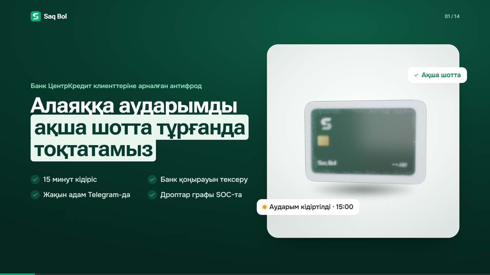
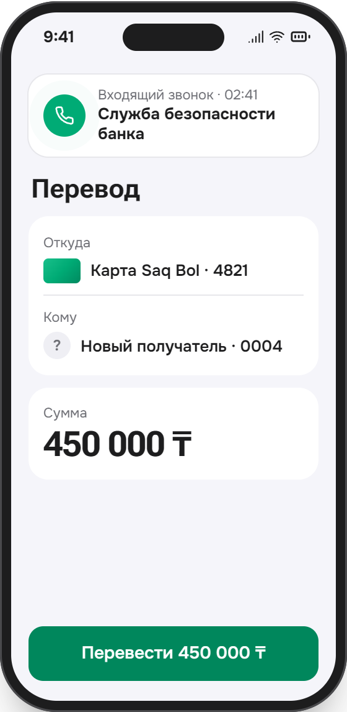
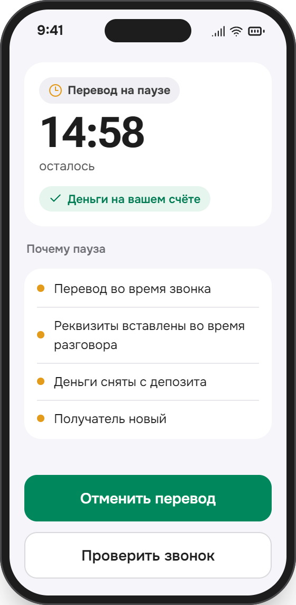
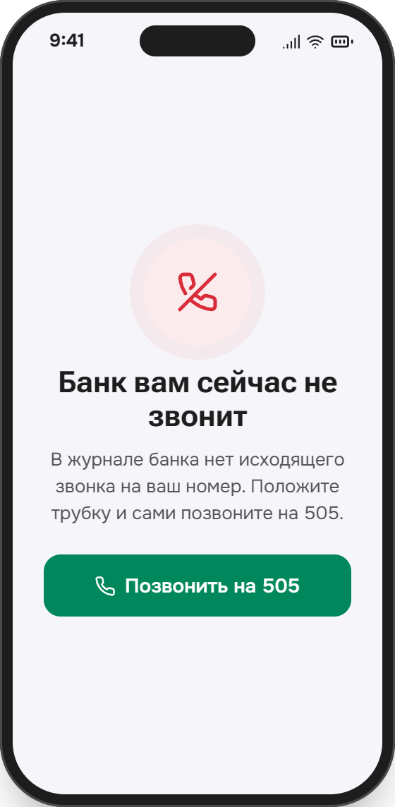
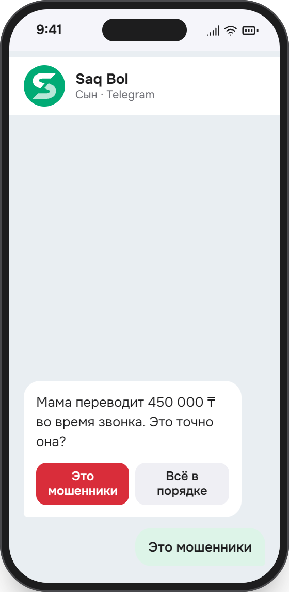
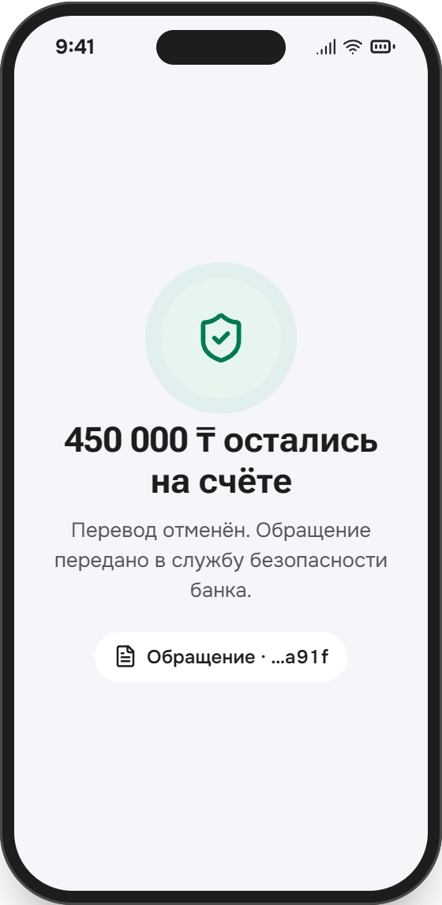
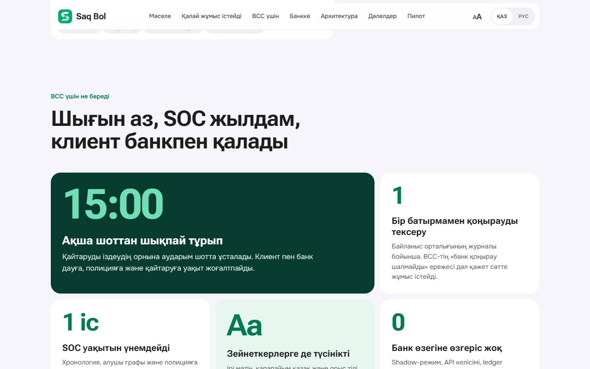
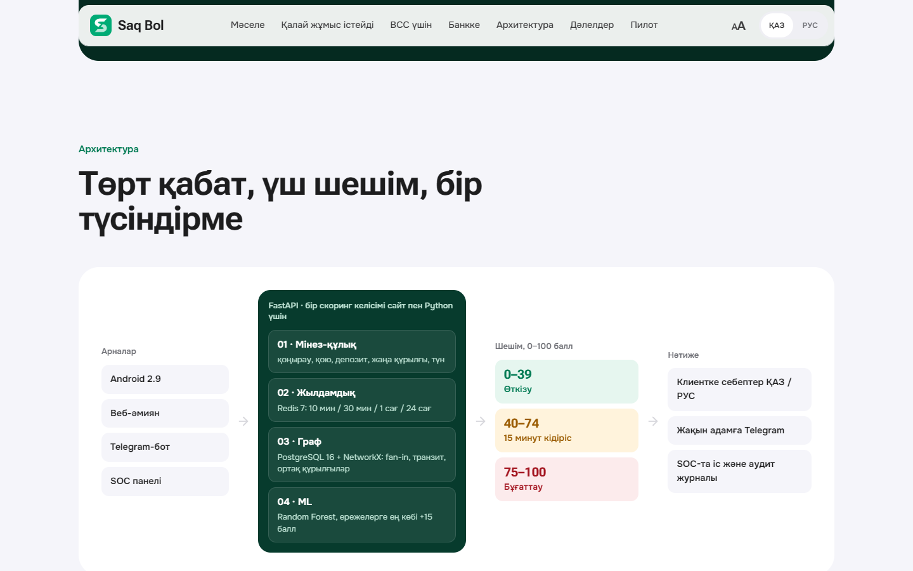
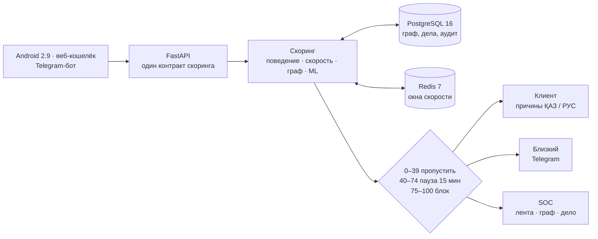

<p align="center">
  
</p>

<h1 align="center">Saq Bol</h1>

<p align="center">
  <b>Алаяққа аударымды ақша шотта тұрғанда тоқтатамыз.</b><br>
  Останавливаем перевод мошеннику, пока деньги ещё на счёте.
</p>

<p align="center">
  <a href="https://saq-bol-bcc.zerdeliportald.workers.dev/pitch"><b>Питч · 5 мин</b></a> ·
  <a href="https://saq-bol-bcc.zerdeliportald.workers.dev/mobile?tour=1"><b>Демо · 2 мин</b></a> ·
  <a href="https://saq-bol-bcc.zerdeliportald.workers.dev/"><b>Сайт</b></a> ·
  <a href="https://saq-bol-jury.onrender.com/"><b>Стенд жюри</b></a> ·
  <a href="https://saq-bol-bcc.zerdeliportald.workers.dev/download/android/"><b>Android 2.9</b></a>
</p>

<p align="center">
  <a href="https://saq-bol-bcc.zerdeliportald.workers.dev/pitch"></a>
</p>

Антифрод для клиентов Банка ЦентрКредит, кейс ITU Hackathon 2026. Когда человек под диктовку «службы безопасности» переводит деньги, Saq Bol **держит перевод 15 минут на сервере**, объясняет причины на казахском и русском, **сверяет звонок с журналом банка**, зовёт **близкого человека в Telegram** и показывает сотруднику SOC **всю сеть дропов** за получателем.

На стенде учебные счета и виртуальные тенге. Реальные платежи не проводятся.

---

## Один перевод, пять экранов · Бір аударым, бес экран

<table>
  <tr>
    <td align="center" width="20%"></td>
    <td align="center" width="20%"></td>
    <td align="center" width="20%"></td>
    <td align="center" width="20%"></td>
    <td align="center" width="20%"></td>
  </tr>
  <tr>
    <td valign="top"><b>1. Звонок.</b> «Сотрудник банка» на линии, реквизиты вставлены из буфера, получатель новый.</td>
    <td valign="top"><b>2. Пауза 15 минут.</b> Деньги на счёте. Четыре причины простыми словами, отмена в один тап.</td>
    <td valign="top"><b>3. «Банк мне звонит?»</b> Журнал банка: исходящего звонка не было. Звонок на 505.</td>
    <td valign="top"><b>4. Близкий.</b> Сын получает сумму и признаки риска и отвечает «Это мошенники».</td>
    <td valign="top"><b>5. Деньги на месте.</b> Перевод отменён, дело с графом и справкой для полиции ушло в SOC.</td>
  </tr>
</table>

## Попробуйте сами · Өзіңіз байқап көріңіз

| Что | Где | Время |
| --- | --- | --- |
| Питч: 14 анимированных слайдов на казахском (→ / пробел, F — полный экран, T — таймер, N — заметки) | [/pitch](https://saq-bol-bcc.zerdeliportald.workers.dev/pitch) · [на русском](https://saq-bol-bcc.zerdeliportald.workers.dev/pitch?lang=ru) · PDF [ҚАЗ](docs/pitch/Saq-Bol-pitch-kk.pdf) / [РУС](docs/pitch/Saq-Bol-pitch-ru.pdf) · [текст выступления](docs/PITCH_5MIN_KK.md) | 5 мин |
| Тур по продукту прямо в браузере, без входа | [Смотреть демо](https://saq-bol-bcc.zerdeliportald.workers.dev/mobile?tour=1) | 2 мин |
| Настоящий сервер: роли, дела, граф, аналитика | [Стенд жюри](https://saq-bol-jury.onrender.com/) → **«Открыть с историей»** | 5 мин |
| Android-кошелёк | [APK 2.9](https://saq-bol-bcc.zerdeliportald.workers.dev/download/android/), SHA-256 в [манифесте](https://saq-bol-bcc.zerdeliportald.workers.dev/downloads/current.json) | 3 мин |
| Экономика пилота и ответы на вопросы жюри | [/pitch/console](https://saq-bol-bcc.zerdeliportald.workers.dev/pitch/console) | — |

### Учебные входы · Оқу тіркелгілері

Это намеренно открытые учебные данные: они открывают только учебную комнату с синтетическими операциями.

| Роль | Логин | Пароль | Что внутри |
| --- | --- | --- | --- |
| Клиент | `client_demo` | `SaqBol-Client-2026` | Кошелёк: переводы, пауза, «Банк мне звонит?», проверка сообщений и ссылок, спорные зачисления |
| Сотрудник SOC | `admin_demo` | `SaqBol-Officer-2026` | Дела, лента, граф получателя, аналитика 7 / 30 / 90 дней и CSV, обратный звонок |
| Администратор платформы | `platform_demo` | `SaqBol-Platform-2026` | Нагрузка API, ошибки 429 и 5xx, доступ сотрудников |

В комнате 40 переводов, семь получателей и десять дел ([состав данных](docs/DEMO_DATA_RU.md)). Комната очищается через 30 минут без действий. Бесплатный сервер просыпается до минуты, поэтому откройте стенд заранее.

## Что получает BCC · BCC үшін не береді

<p align="center"></p>

- **Деньги остаются на счёте.** Пауза срабатывает до списания, банку не нужно искать возврат.
- **Правило «банк не звонит» работает в нужный момент.** Клиент проверяет звонок одной кнопкой по журналу контакт-центра.
- **SOC тратит меньше времени.** Хронология, граф получателя и справка для полиции собираются сами.
- **Понятно пенсионерам.** Крупный текст (кнопка «Aa» на сайте, «Профиль → Крупный текст» в Android), простой казахский и русский, одно действие на экран, близкий рядом.
- **Ядро банка не трогаем.** Shadow-режим, API-контракт, адаптер к ledger, запуск в Docker внутри периметра.
- **Каждое решение объяснимо.** У каждого балла есть причина, действия пишутся в журнал аудита.

## Что умеет · Мүмкіндіктер

**Клиент (Android, веб)**
- Пауза 15 минут на сервере для перевода новому получателю во время звонка, причины на ҚАЗ и РУС, отмена и «Сообщить об обмане».
- «Банк мне звонит?» по учебному журналу исходящих звонков банка.
- Проверка сообщения и ссылки: подозрительные слова подсвечиваются на телефоне, ссылка сверяется с bcc.kz.
- Пауза снятия наличных в банкомате после подозрительного звонка (симуляция).
- Спорное зачисление: «Сообщить и зарезервировать эту сумму», остальным остатком можно пользоваться.
- Крупный текст и тёмная тема в профиле.

**Близкий человек (Telegram)**
- Получает сумму и признаки риска. Деньгами не распоряжается, но ответ «Это мошенники» блокирует подтверждение.

**Сотрудник SOC**
- Лента переводов, дела с очередью первого часа и обратным звонком клиенту.
- Граф получателя: скорость входящих, транзит, общие устройства, путь денег, квитанции зачислений.
- Аналитика за 7 / 30 / 90 дней: исходы удержаний, частота правил, время первой реакции, выгрузка CSV.
- Спорный перевод: отправитель и получатель отвечают по отдельной ссылке, SOC видит оба объяснения.
- Реестр поддельных доменов и Telegram-аккаунтов с черновиками заявок на блокировку.
- Справка для полиции по делу.

## Требования кейса · Кейс талаптары

| Что просил банк | Что сделали | Подтверждение |
| --- | --- | --- |
| Остановить мошеннический перевод до списания | Сервер держит перевод 15 минут, даёт отменить и заново проверяет получателя | 57 из 60 на учебном стенде |
| Защитить клиента во время перевода | Сигналы звонка и ввода, анкета, проверка звонка по журналу банка, близкий в Telegram | Android, веб, бот |
| Находить подозрительные операции и сети дропов | Граф получателя в PostgreSQL, окна 10 мин / 30 мин / 1 ч / 24 ч в Redis | 13 отправителей → 1 хаб |
| Объяснимое решение на казахском и русском | Балл 0–100, причины для клиента и SOC, вклад признаков модели | ҚАЗ / РУС на каждом экране |
| Реальный стек и оценка быстрее 50 мс | FastAPI, PostgreSQL 16, Redis 7, NetworkX, Random Forest | p95 ядра 5 мс |
| Полный путь от перевода до SOC | Приложение → решение → лента SOC, граф, дело, справка | Android 2.9, веб, SOC |

## Архитектура · Архитектура

<p align="center"></p>



1. **Поведение.** Звонок, снятие с депозита, вставка реквизитов, пауза при вводе, новое устройство, ночь. IP и регион учитываются, только когда их подтвердил банк.
2. **Скорость.** Счётчики Redis за 10 минут, 30 минут, 1 час и 24 часа.
3. **Граф.** Агрегаты в PostgreSQL общие для всех процессов скоринга, расчёт на NetworkX: fan-in, транзит, общие устройства, мгновенный вывод.
4. **ML.** Random Forest на синтетике ([`model.py`](backend/app/ml/model.py), [`training.py`](backend/app/ml/training.py)) добавляет не больше 15 баллов и не блокирует в одиночку.

Решение принимают правила, поэтому у каждого балла есть причина. Внешние ИИ-сервисы не нужны. Сайт — Next.js на Cloudflare Workers, API — Render (FastAPI, PostgreSQL, Redis), Android — Capacitor, локально — Docker Compose.

## Результаты · Нәтижелер

| Что измерено | Результат | Условия |
| --- | --- | --- |
| Учебный стенд, 120 переводов | Остановлено 57 из 60 мошеннических, лишняя пауза у 4 из 60 обычных | Синтетика. `python -m scripts.scenario_stand` повторяет [SCENARIO_STAND.md](docs/SCENARIO_STAND.md) |
| Скорость оценки | p95 ядра 5,00 мс, полный HTTP-запрос с PostgreSQL 98,86 мс | 500 вызовов, реальный Redis, Ryzen 5 7535HS ([PERFORMANCE.md](docs/PERFORMANCE.md)) |
| Модель на редком мошенничестве | Точность 1,17 % при доле 0,05 % (89,29 % при исходной доле) | Зафиксированная выборка 20 000, хэш проверяется до расчёта ([MODEL_EVALUATION.md](docs/MODEL_EVALUATION.md)). Поэтому модель не решает в одиночку |
| Реальные данные ULB (Kaggle) | 91 из 114 мошеннических при 1,3 ложных тревоги на 1 000 честных | Европейские карты 2013 года без признака звонка, к клиентам BCC напрямую не переносится ([REAL_DATA_ULB_RU.md](docs/REAL_DATA_ULB_RU.md)) |
| Автотесты | Backend 829, frontend 214, Android 55 | `./verify.sh` |

## Честно о границах · Шектеулер

- **Данные.** Все цифры получены на синтетике или открытых данных. Ложные паузы на P2P-переводах банка ещё предстоит измерить, поэтому мы предлагаем shadow-пилот: считаем рядом с текущим антифродом и ничего не останавливаем.
- **Интеграции.** Журнал звонков, Telegram в туре и банкомат смоделированы. Для пилота нужны авторизация клиента банка, источник звонков и устройств, платёжный адаптер.
- **Масштаб.** Нагрузочные испытания и отказоустойчивость входят в условия пилота. Подробно — [PILOT.md](docs/PILOT.md).

## Запуск · Іске қосу

```sh
docker compose -f docker-compose.jury.yml up -d --build --wait
```

[Кошелёк](http://127.0.0.1:18002/wallet/) открывается под учебными ролями из таблицы выше. Полный сайт и API — `.\scripts\start-demo.ps1` (Windows) или `bash scripts/start-demo.sh`, проверка — `bash verify.sh`. [Сайт](http://localhost:3000) · [Swagger](http://localhost:8000/docs) · [Без Docker](docs/PRODUCT_GUIDE.md#run) · [Деплой](docs/PRODUCT_GUIDE.md#deploy)

<details>
<summary>Комнаты жюри локально и деплой</summary>

```sh
docker compose -f docker-compose.jury.yml run --rm --publish 127.0.0.1:18003:8000 wallet python -m scripts.jury_wallet
```

Затем откройте [локальные комнаты](http://localhost:18003/jury).

**API · Render.** Blueprint из [`deploy/render-api.yaml`](deploy/render-api.yaml): FastAPI, PostgreSQL и Redis. После миграций проверьте `/health`.

**Сайт · Cloudflare Workers.** Имя Worker и адреса — в [`frontend/wrangler.jsonc`](frontend/wrangler.jsonc), служебные ключи — в секретах Worker.
</details>

## Команда · Команда

**Дамир** — backend, объединение, питч · **Айдана** — клиентское приложение, UX · **Танирберді** — SOC, граф, возвраты · **Бекзат** — Telegram, интеграции

[Руководство](docs/PRODUCT_GUIDE.md) · [API](docs/API_CONTRACTS.md) · [Учебные данные](docs/DEMO_DATA_RU.md) · [Telegram](docs/integrations/TELEGRAM_BOT_SETUP.md) · [Пилот](docs/PILOT.md) · [Дизайн](docs/DESIGN_SYSTEM.md) · [Приёмка 26 ноября](docs/ACCEPTANCE_2026_11_26_RU.md)
