# Saq Bol

**Защита P2P-переводов от телефонных мошенников · Телефон алаяқтарынан P2P-аударымдарды қорғау**

Saq Bol ставит на паузу перевод, который клиент делает во время звонка, сверяет звонок с журналом банка, предупреждает близкого человека и показывает сотруднику банка всю сеть получателей. Это независимый прототип для кейса Банка ЦентрКредит (ITU Hackathon 2026). На стенде используются учебные счета и виртуальные тенге, реальные платежи не проводятся.

Saq Bol қоңырау кезінде жасалған аударымды кідіртеді, қоңырауды банк журналы бойынша тексереді, жақын адамға хабарлайды және банк қызметкеріне алушылардың бүкіл желісін көрсетеді. Стендте оқу шоттары мен виртуалды теңге қолданылады.

**[Сайт](https://saq-bol-bcc.zerdeliportald.workers.dev/)** · **[Демо за 2 минуты / 2 минуттық демо](https://saq-bol-bcc.zerdeliportald.workers.dev/mobile?tour=1)** · **[Стенд жюри с входом / Қазылар стенді](https://saq-bol-jury.onrender.com/)** · **[Android 2.9 (APK)](https://saq-bol-bcc.zerdeliportald.workers.dev/download/android/)**

  <a href="docs/screenshots/readme/site-home-ru.png">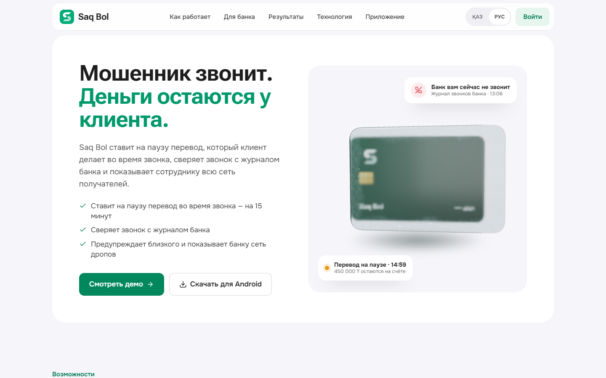</a>
  <a href="docs/screenshots/readme/app-home-ru.png">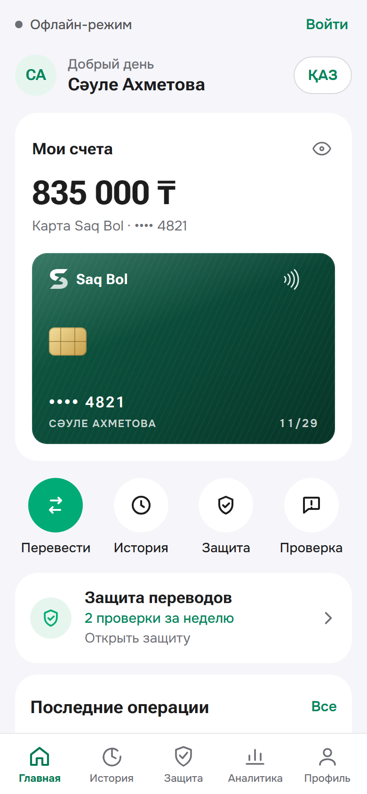</a>

## Показ за 3 минуты / 3 минуттық көрсетілім

1. Откройте [главную](https://saq-bol-bcc.zerdeliportald.workers.dev/) и нажмите **«Смотреть демо»**. Переключатель **ҚАЗ / РУС** в шапке переводит экран, причины и статусы, текущий шаг не сбрасывается.
2. **Шаг 1.** Маме звонит «служба безопасности банка». Она переводит 450 000 ₸ на новую карту. Нажмите **«Перевести»**.
3. **Шаг 2.** Перевод на паузе на 15 минут, деньги на счёте. Видны причины: идёт звонок, номер карты вставлен во время разговора, пауза при вводе. Ответьте на вопрос о звонке.
4. **Шаг 3.** «Банк мне звонит?» Журнал звонков банка показывает, что банк не звонил.
5. **Шаг 4.** Сын получает сообщение в Telegram и отвечает **«Это мошенники»**. Перевод заблокирован.
6. **Шаг 5.** Сотрудник SOC видит перевод в ленте, граф получателя (12 отправителей сходятся на одном счёте) и вклад признаков модели.
7. **Шаг 6.** Справка для полиции с хронологией и статьями закона РК собирается сама.

В публичном туре решение считает браузер по тем же правилам, звонок и Telegram в нём смоделированы. Решения настоящего сервера, роли и дела проверяются в [комнате жюри](#accounts).

  <a href="docs/screenshots/readme/tour-pause-ru.png">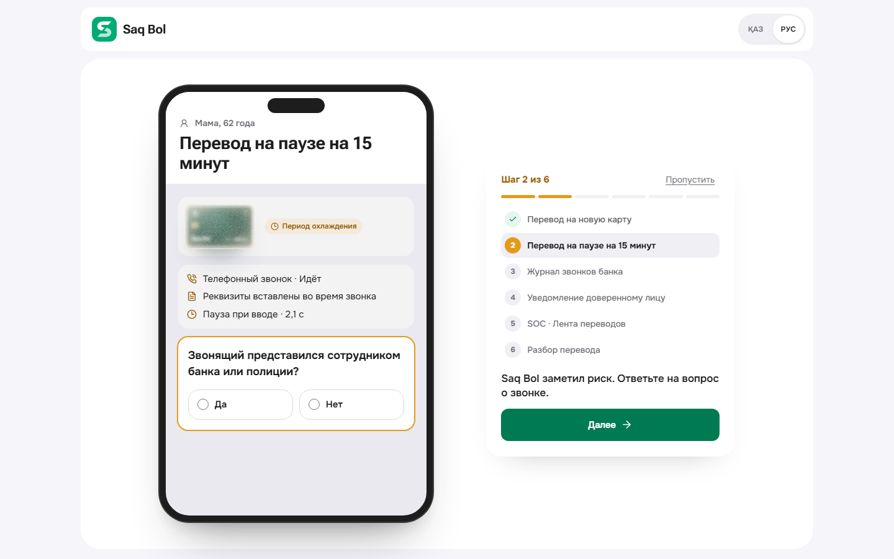</a>
  <a href="docs/screenshots/readme/tour-soc-ru.png">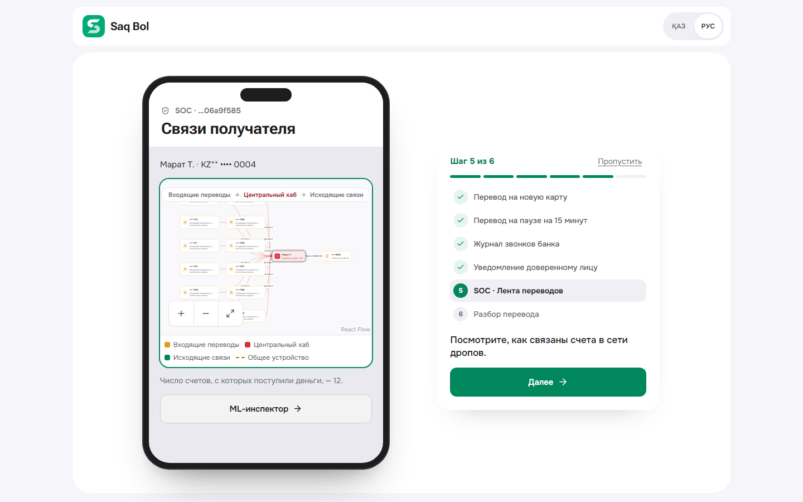</a>

## Учебные входы и данные / Оқу тіркелгілері

На [стенде жюри](https://saq-bol-jury.onrender.com/) нажмите **«Открыть с историей / Тарихымен ашу»** и войдите под одной из учебных ролей. Это намеренно открытые учебные данные, они не дают доступа ни к чему, кроме учебной комнаты.

| Роль / Рөл | Логин | Пароль / Құпиясөз | Что открывается |
| --- | --- | --- | --- |
| Клиент | `client_demo` | `SaqBol-Client-2026` | Кошелёк: переводы, пауза, защита, проверка сообщений и ссылок, обращения |
| Сотрудник SOC / SOC қызметкері | `admin_demo` | `SaqBol-Officer-2026` | Дела, лента, граф получателя, аналитика порогов, обратный звонок |
| Администратор платформы / Платформа әкімшісі | `platform_demo` | `SaqBol-Platform-2026` | Нагрузка API, ошибки, доступ сотрудников |

- **Что в комнате.** 40 учебных переводов, семь получателей и десять дел. Состав учебных данных описан в [DEMO_DATA_RU.md](docs/DEMO_DATA_RU.md).
- **Один перевод глазами двух ролей.** Откройте **«Ссылка на вашу комнату»** во втором профиле браузера.
- **Срок жизни.** Комната очищается через 30 минут без действий или после перезапуска сервиса. Бесплатный сервер может просыпаться до минуты: откройте стенд за пару минут до показа.
- **Android.** APK подключается к отдельному командному стенду, его пароль выдаёт команда. Версия, размер и SHA-256 опубликованы в [манифесте](https://saq-bol-bcc.zerdeliportald.workers.dev/downloads/current.json). Инструкция — [ANDROID.md](docs/ANDROID.md).

## Что умеет Saq Bol / Мүмкіндіктер

| Роль | Где | Что попробовать |
| --- | --- | --- |
| Клиент | Кошелёк → Перевод | Перевод знакомому проходит сразу. Перевод новому получателю во время звонка встаёт на паузу 15 минут с причинами на ҚАЗ и РУС. Его можно отменить или сообщить об обмане. |
| Клиент | Кошелёк → Защита → «Банк мне звонит?» | Звонок сверяется с учебным журналом исходящих звонков банка: был звонок или нет, кто и когда звонил. |
| Клиент | Кошелёк → Защита → «Проверить сообщение»; в веб-клиенте ещё и «Проверить ссылку» | Подозрительные слова в тексте или на скриншоте подсвечиваются на телефоне, текст никуда не отправляется. Ссылка сверяется с доменом bcc.kz без открытия страницы. |
| Клиент | Кошелёк → входящая операция | **«Сообщить и зарезервировать эту сумму»**: ошибочное зачисление удерживается, остальным остатком можно пользоваться. |
| Доверенный человек | Telegram-бот | Получает сообщение об удержанном переводе и отвечает «Это мошенники» или «Всё в порядке». |
| Сотрудник SOC | Кабинет → Дела → Ждут сотрудника | Сверху самое давнее обращение и время до конца первого часа, затем перевод, история дела и обратный звонок клиенту. |
| Сотрудник SOC | Кабинет → перевод → Граф | Граф получателя, путь денег и квитанции зачислений за 24 часа до решения. Отсюда же — справка для полиции. |
| Сотрудник SOC | Кабинет → Аналитика | Сравнение действующей политики с порогами 25, 30, 35 и 40 на одних и тех же операциях: пропущенное мошенничество и ложные паузы. |
| Администратор | Кабинет администратора | Нагрузка API за 15 минут, ответы 429 и 5xx, доступ сотрудников. |
| Жюри | [Комната жюри → CSV](https://saq-bol-jury.onrender.com/jury/trial) | Загрузите свои учебные переводы, зафиксируйте прогноз двух моделей и только потом откройте ответы. |

  <a href="docs/screenshots/readme/site-features-ru.png">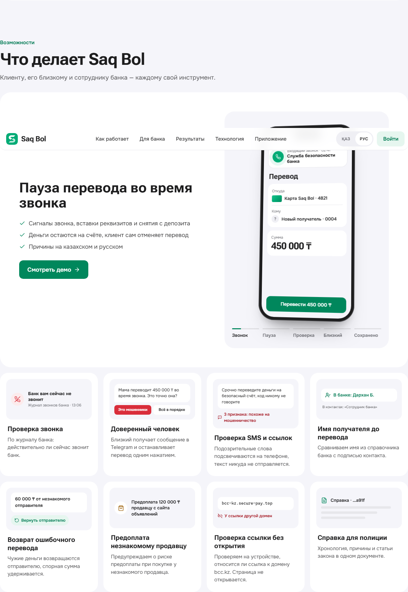</a>

Ещё экраны / Басқа экрандар

  <a href="docs/screenshots/readme/site-drops-ru.png">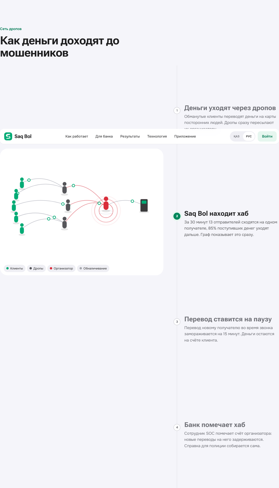</a>
  <a href="docs/screenshots/readme/site-requirements-ru.png">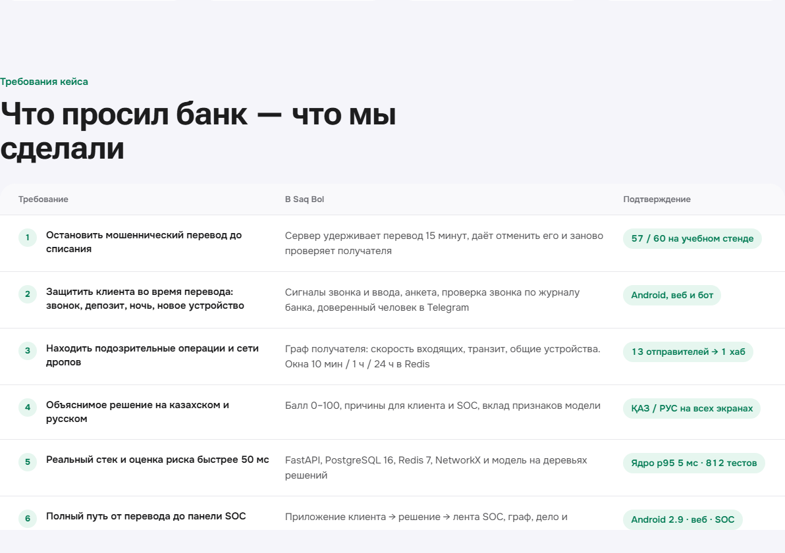</a>
  <a href="docs/screenshots/readme/site-soc-ru.png">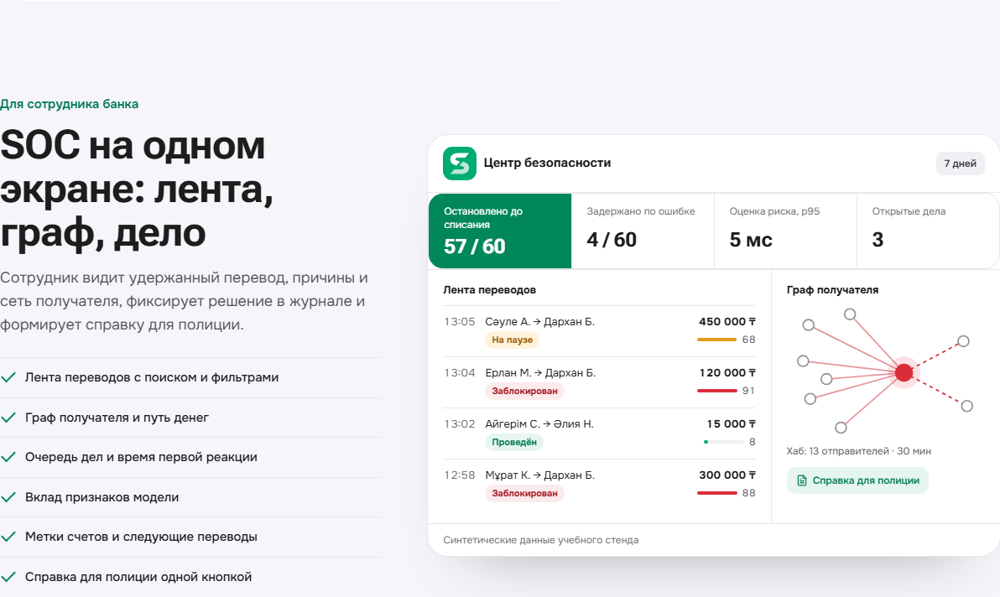</a>

  <a href="docs/screenshots/readme/app-signin-ru.png">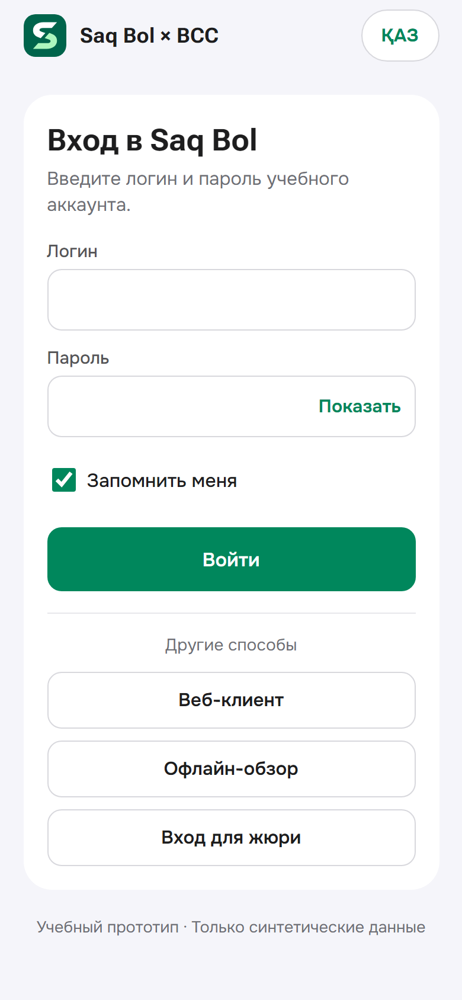</a>
  <a href="docs/screenshots/readme/app-history-ru.png">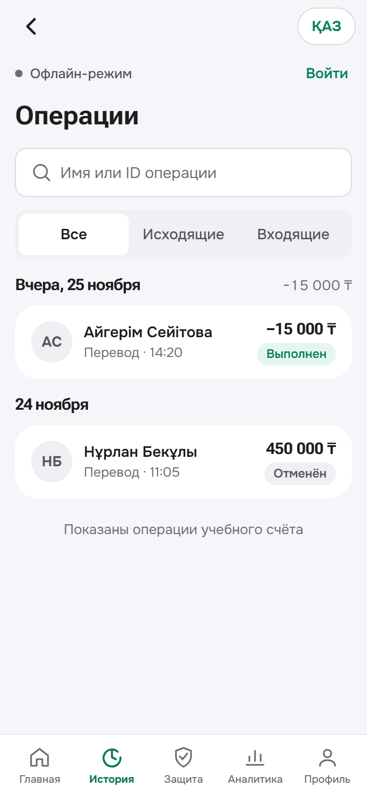</a>
  <a href="docs/screenshots/readme/app-safety-ru.png">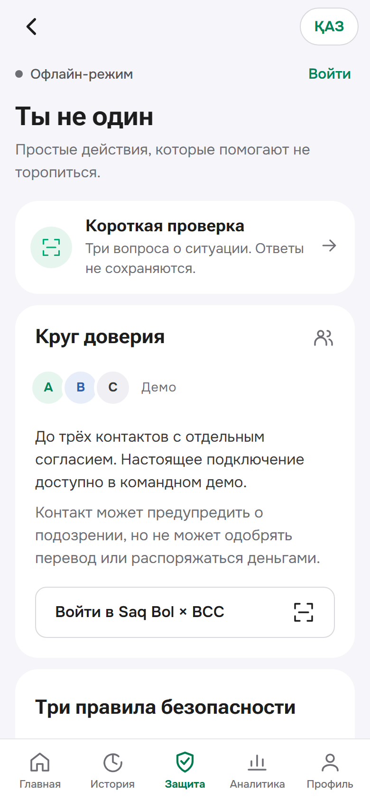</a>
  <a href="docs/screenshots/readme/app-analytics-ru.png">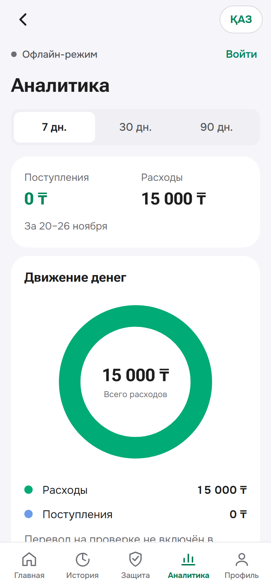</a>
  <a href="docs/screenshots/readme/site-phone-ru.png">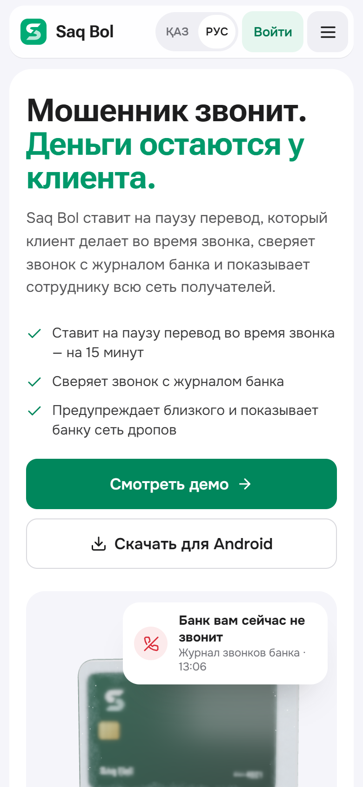</a>

  <a href="docs/screenshots/readme/wallet-case-callback.png">Обратный звонок клиенту в деле SOC</a> · <a href="docs/screenshots/readme/wallet-platform-traffic.png">Кабинет администратора</a> · <a href="docs/screenshots/readme/disputed-credit-ru.png">Спорное зачисление</a> · <a href="docs/screenshots/readme/first-hour-kk.png">Очередь первого часа</a> · <a href="docs/evidence/release-2.9/cooling_off.pdf">Пакет по удержанному переводу (PDF)</a>

## Как это работает / Қалай жұмыс істейді

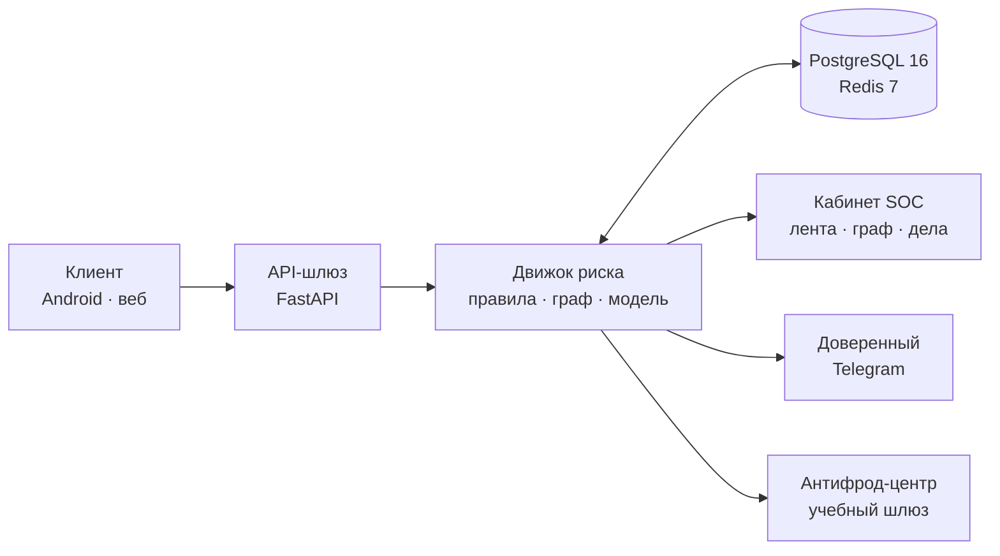

Каждый перевод проходит четыре слоя:
1. Поведенческие сигналы: звонок, снятие с депозита, вставка реквизитов, пауза при вводе, новое устройство, ночь.
2. Окна скорости в Redis: 10 минут, 30 минут, 1 час, 24 часа.
3. Граф получателя на NetworkX: скорость входящих, транзит, общие устройства.
4. Модель Random Forest, обученная на синтетике ([`backend/app/ml/model.py`](backend/app/ml/model.py), [`training.py`](backend/app/ml/training.py)). Модель добавляет не больше 15 баллов и не блокирует перевод сама.

Итоговый балл 0–39 пропускает перевод, 40–74 ставит его на паузу на 15 минут, 75–100 блокирует. Причины решения выводятся на казахском и русском. Сервер считает риск сам, внешние ИИ-сервисы для этого не нужны.

## Результаты и условия замеров / Нәтижелер

| Что измерено | Результат | Условия |
| --- | --- | --- |
| Учебный стенд, 120 переводов | Остановлено 57 из 60 мошеннических, задержано 4 из 60 обычных | Синтетические сценарии. Повтор: `python -m scripts.scenario_stand` даёт тот же отчёт, что [SCENARIO_STAND.md](docs/SCENARIO_STAND.md) |
| Оценка риска ядром | p95 5,00 мс | 500 вызовов, реальный Redis, ноутбук Ryzen 5 7535HS ([PERFORMANCE.md](docs/PERFORMANCE.md)) |
| Полный HTTP-запрос с сохранением | p95 98,86 мс | Один клиент, тот же ноутбук ([PERFORMANCE.md](docs/PERFORMANCE.md)) |
| Перевод знакомому во время звонка | Новая модель задержала бы 206 из 768 честных и поймала 330 из 512 мошеннических; действующая — 242 и 339 | Синтетика, решение принимает действующая v3 ([MODEL_EVALUATION.md](docs/MODEL_EVALUATION.md)) |
| Реальные данные ULB/Kaggle | 91 из 114 мошеннических при 1,3 ложных тревоги на 1 000 честных; только на реальных примерах — 83 из 114 | Европейские карточные операции 2013 года без признака звонка; к клиентам BCC напрямую не переносится ([REAL_DATA_ULB_RU.md](docs/REAL_DATA_ULB_RU.md)) |
| Автотесты | Backend 812 прошли, 37 пропущены, ещё 3 в отдельном прогоне; frontend 211; Android 50; браузерные сценарии кошелька 38 прошли, 7 пропущены | `./verify.sh`, `npm test`, `npm run test:ui` в `android-app` |

## Чего пока нет / Әлі жоқ

- **Сигналы из SPEC.** Нет кластеров по IP и признака «новый город» относительно истории клиента. Общий `device_id` учитывается.
- **Масштабирование.** Граф хранится в памяти, поэтому backend работает одним процессом.
- **Старые телефоны.** На Android 11 с заводским WebView 83 кошелёк открывается пустым экраном. Исправление лежит в ветке `fix/saq-bol-final-29-readiness` и ещё не перенесено.
- **Банковский пилот.** Нужны авторизация клиента банка, подтверждённые источники звонков и устройств, платёжный адаптер, проверка ложных пауз на размеченных P2P-переводах банка и нагрузочные испытания. Подробно — [PILOT.md](docs/PILOT.md).

## Локальный запуск / Жергілікті іске қосу

**Docker Compose v2.** Выполните из корня репозитория.

~~~sh
docker compose -f docker-compose.jury.yml up -d --build --wait
~~~

[Кошелёк](http://127.0.0.1:18002/wallet/) открывается под теми же учебными ролями. Комнаты с историей, ключом устройства и приглашением доверенного лица запускаются отдельно, затем откройте [локальные комнаты](http://localhost:18003/jury).

~~~sh
docker compose -f docker-compose.jury.yml run --rm --publish 127.0.0.1:18003:8000 wallet python -m scripts.jury_wallet
~~~

Полный сайт и API — `.\scripts\start-demo.ps1` (Windows) или `bash scripts/start-demo.sh` (Linux, macOS). Проверка — `.\verify.ps1` или `bash verify.sh`. [Сайт](http://localhost:3000) · [Swagger](http://localhost:8000/docs) · [Запуск без Docker](docs/PRODUCT_GUIDE.md#run)

## Деплой / Орналастыру

**API · Render.** Создайте Blueprint из [`deploy/render-api.yaml`](deploy/render-api.yaml): FastAPI, PostgreSQL и Redis. После миграций проверьте `/health`.

**Сайт · Cloudflare Workers.** Задайте в [`frontend/wrangler.jsonc`](frontend/wrangler.jsonc) имя Worker, адреса API и сайта, затем добавьте служебные ключи в секреты Worker. [Команды сборки и деплоя](docs/PRODUCT_GUIDE.md#deploy)

[Руководство по продукту](docs/PRODUCT_GUIDE.md) · [API](docs/API_CONTRACTS.md) · [Учебные данные](docs/DEMO_DATA_RU.md) · [Telegram](docs/integrations/TELEGRAM_BOT_SETUP.md) · [Закрытый пилот](docs/PILOT.md) · [Дизайн](docs/DESIGN_SYSTEM.md) · [Материалы команды](docs/HACKATHON_HANDOFF.md)
