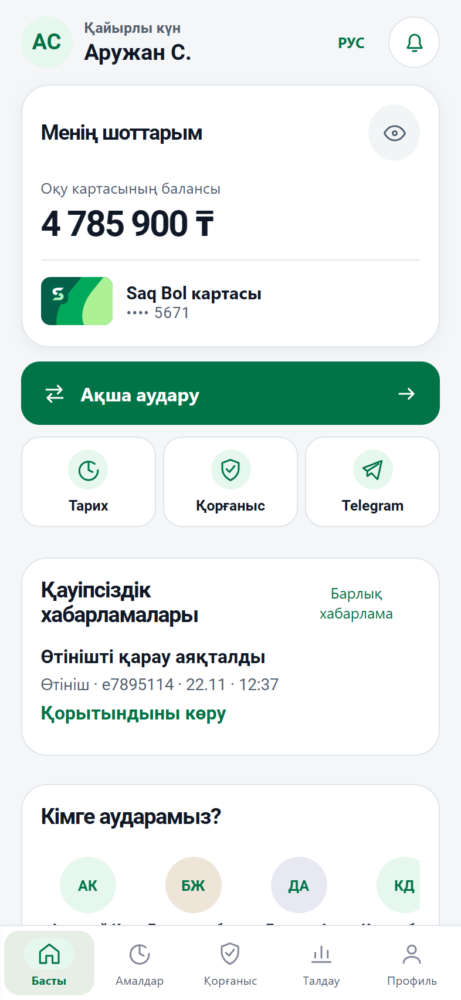
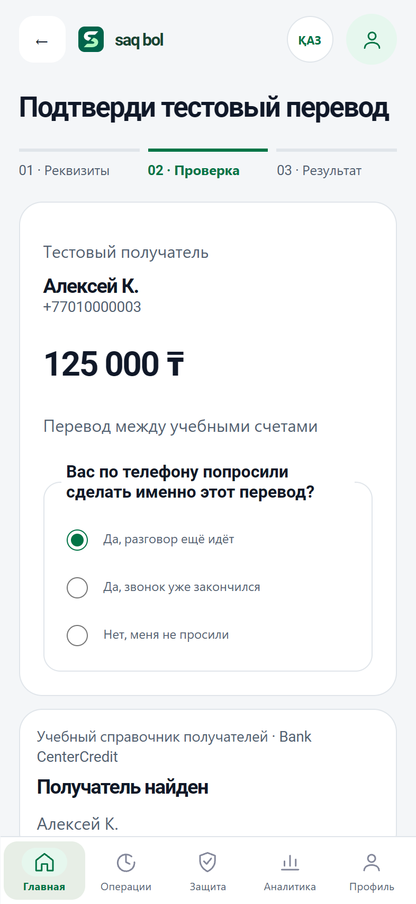
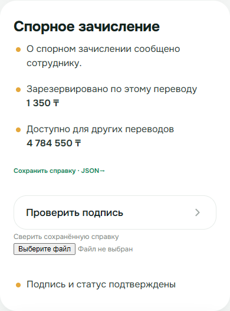
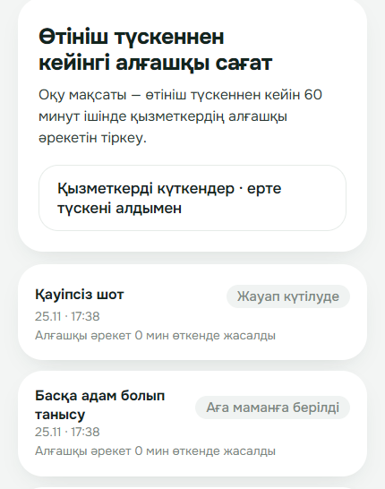

# Saq Bol × BCC

**Аударым кезіндегі алаяқтықтан қорғау · Защита от мошенничества при переводах**

Saq Bol — ITU Hackathon 2026 аясындағы Bank CenterCredit кейсіне арналған тәуелсіз прототип. Клиент аударымды тексереді, ал күмән туса, қауіпсіздік қызметкері сол операция бойынша өтінішті қарайды. Стендте оқу шоттары мен виртуалды теңге қолданылады.

Saq Bol — независимый прототип для кейса Bank CenterCredit на ITU Hackathon 2026. Клиент видит, кому уходят деньги и почему перевод поставлен на паузу. Сотрудник службы безопасности (SOC) может разобрать ту же операцию и ответить клиенту. На стенде используются учебные счета и виртуальные тенге.

**[Әмиянға кіру / Открыть кошелёк жюри](https://saq-bol-jury.onrender.com/)** · [Сайт және SOC / Сайт и SOC](https://saq-bol-bcc.zerdeliportald.workers.dev/) · [Android 2.9 жүктеу / Скачать APK](https://saq-bol-bcc.zerdeliportald.workers.dev/download/android/)

  
  

[Кері қоңырау / Обратный звонок клиенту](docs/screenshots/readme/wallet-case-callback.png) · [Әкімші кабинеті / Кабинет администратора](docs/screenshots/readme/wallet-platform-traffic.png) · [Экрандар галереясы / Галерея экранов](docs/PRODUCT_GUIDE.md#screens)

[Android орнату беті және QR / Страница установки Android и QR](docs/screenshots/readme/android-install-ru.png)

Даулы түсім мен қызметкер кезегі / Спорное зачисление и очередь сотрудника

  
  

[Аударым кідіртілген кездегі құжат / Пример пакета по приостановленному переводу (PDF)](docs/evidence/release-2.9/cooling_off.pdf) · [Сол аударымды тоқтатқаннан кейін / Тот же перевод после отмены (PDF)](docs/evidence/release-2.9/cancelled.pdf)

## Әмиянға кіру / Вход в кошелёк

[Қазыларға арналған екі минуттық тур / Демо для жюри · 2 минуты](https://saq-bol-bcc.zerdeliportald.workers.dev/mobile?tour=1)

Қазылар стендінде **«Тарихымен ашу»** түймесін басыңыз. Төмендегі оқу тіркелгісінің логині мен құпиясөзін енгізіңіз. Кірген соң тиісті кабинет ашылады. Бөлмеде 40 оқу аударымы, жеті алушы және он іс бар. Бір аударымды екі рөлде көру үшін бастапқы беттегі **«Бөлме сілтемесін»** басқа браузер профилінде ашыңыз.

На стенде жюри нажмите **«Открыть с историей»**. Введите логин и пароль учебной учётной записи из таблицы. После входа откроется её кабинет. В комнате уже есть 40 учебных переводов, семь получателей и десять дел. Чтобы проверить один перевод глазами клиента и сотрудника, откройте **«Ссылка на вашу комнату»** из стартовой страницы во втором профиле браузера. [Открыть стенд / Стендті ашу](https://saq-bol-jury.onrender.com/)

| Рөл / Роль | Логин | Құпиясөз / Пароль |
| --- | --- | --- |
| Клиент | `client_demo` | `SaqBol-Client-2026` |
| SOC қызметкері / Сотрудник SOC | `admin_demo` | `SaqBol-Officer-2026` |
| Платформа әкімшісі / Администратор платформы | `platform_demo` | `SaqBol-Platform-2026` |

Оқу бөлмесі 30 минут әрекетсіздіктен кейін немесе сервис қайта қосылғанда тазарады. Android қолданбасы команданың бөлек стендіне қосылады және оған команда берген құпиясөз қажет.

Учебная комната очищается через 30 минут бездействия или при перезапуске сервиса. Приложение Android подключается к отдельному командному стенду. Для входа в APK используется тестовый пароль от команды. [Android нұсқаулығы / Инструкция Android](docs/ANDROID.md)

**2.9.** Қауіпсіздік қызметкері өтініштен алушының аударым алдындағы 24 сағатта орындалған операцияларын қарай алады. Клиент іс бойынша жауапты өз әмиянынан оқиды.

В карточке обращения сотрудник может проверить исполненные операции получателя за 24 часа до перевода. Клиент видит ответ службы безопасности в своём кошельке. [2.9 тексерулері / Проверки выпуска](docs/FINAL_ACCEPTANCE_RU.md) · [Android Studio](docs/ANDROID_STUDIO_HANDOFF_RU.md)

## Не тексеруге болады

Қазылар өз оқу аударымдарын CSV форматында жүктеп, екі модельдің болжамын жауаптарды ашуға дейін бекіте алады. Жинақты тексеру кезінде тізілімнің дерегі уақытында алынғанын және дәл сол төлемге қатысты екенін қараңыз. Хабарлама тексерісінде күдікті сөздер құрылғыда белгіленеді. Клиент өз өтінішіне бір санатты қосуға келісім бере алады. [CSV сынағы](https://saq-bol-jury.onrender.com/jury/trial) · [Жинақтың төлемі](https://saq-bol-bcc.zerdeliportald.workers.dev/#settlement-proof)

- **Клиент.** «Менің шоттарым» бөлімінде балансты жасырып көріңіз. Аударым үшін алушыны таңдаңыз да, соманы енгізіңіз немесе дайын соманы басыңыз. Қоңырау туралы жауап шешімге әсер етуі мүмкін болса, қолданба алушыны тексергенде бір сұрақ қояды. Қауіпті аударым кідіртілсе, клиент себебін оқып, аударымнан бас тарта алады немесе алаяқтық туралы хабарлай алады. Отбасылық қорғау қосулы болса, сенімді адам соманы және алушыны тексере алады.
- **SOC қызметкері мен әкімші.** Қызметкер өтініштен аударым мен оқиғалар тарихын ашып, клиентке кері қоңырау ұсынады. «Аналитикада» қолданыстағы саясат пен 25, 30, 35 және 40 балдық шектерді бірдей операциялар бойынша салыстырады. Платформа әкімшісі сұрауларды, қателерді және қызметкердің кіру рұқсатын көреді.
- **Сайттағы салыстыру.** Екі шотқа да он екі адам 15 000 ₸-ден аударады. SOC панелінде тәуекел белгісін ашып, оған қатысты оқу аударымдарының уақытын, сомасын және алушысын көріңіз. [Екі шотты салыстыру](https://saq-bol-bcc.zerdeliportald.workers.dev/#collection-comparison)

Қазылар бөлмесінде **Қорғаныс → Құрылғы кілті** арқылы WebAuthn кілтін қосуға болады. Содан кейін сол бөлмедегі әр аударымның сомасы мен алушысы жеке расталады. SOC қызметкері түбіртектен растау уақытын көреді. Іс карточкасында Б оқу банкі А оқу банкінің қолтаңбасын тексеріп, ескертудің әлі күшінде екенін анықтайды.

Сайттың **Нәтижелер** бөлімінде 120 оқу аударымына кідіріс шегін таңдап, өткізіп алған алаяқтық пен кідіртілген адал төлемдердің сомаларын салыстырыңыз. Қызметкер кабинетінде графты нақты аударымнан ашып, алушыға тиесілі байланысты таңдаңыз. Тізімде шешімге дейінгі 24 сағатта осы бағытта орындалған теңгелік аударымдар көрсетіледі.

Кіріс аударымын басқа шотқа қайтаруды сұраса, операцияны ашып, **«Хабарлап, осы соманы резервке қою»** пәрменін таңдаңыз. Шотта қалған қолжетімді ақшаны пайдалана аласыз. Қызметкер істі қараған соң қолтаңбасы бар анықтаманы жүктеп, күйін сол бөлмеде қайта тексеруге болады.

Шешім қабылдағанда сервер ережелерді, алушының байланыс графын, енгізу белгілерін және синтетикалық деректерде оқытылған ML моделін ескереді. 120 оқу сценарийінде 60 алаяқтық аударымның 57-сі тоқтатылды, ал 60 заңды аударымның төртеуі кідіртілді.

Қоңырау кезінде таныс адамға жасалған аударым үшін қызметкер екі модельдің бағасын салыстыра алады. Аударым туралы шешімді v3 қабылдайды. Сынақ моделі соманы, енгізу жылдамдығын және кідірістерді бөлек бағалайды. Сайтта қанша алаяқтық тоқтатылғанын және қанша адал төлемнің кідіргенін көруге болады. [Модельдерді салыстыру](https://saq-bol-bcc.zerdeliportald.workers.dev/#model-trial) · [Өз мысалдарыңызбен тексеру](docs/MODEL_EVALUATION.md#blind-trial)

Қызметкер кабинетінде **Істер → Қызметкерді күткендер** сүзгісін таңдаңыз. Ең ерте түскен өтініш жоғарыға шығады. Журнал алғашқы қызметкер әрекетінің уақытын сақтайды. Оқу мақсаты — бір сағат ішінде қарауға кірісу.

## Что попробовать

В комнате жюри загрузите учебные переводы из CSV, сохраните прогноз обеих моделей и только потом откройте правильные ответы. В сравнении сборов проверьте, меняет ли решение вовремя полученное подтверждение выплаты. В проверке сообщения подозрительные слова выделяются на устройстве. Клиент может выбрать своё открытое обращение и передать в него одну категорию сигнала. [Проверить свой CSV](https://saq-bol-jury.onrender.com/jury/trial) · [Сравнить подтверждения выплаты](https://saq-bol-bcc.zerdeliportald.workers.dev/#settlement-proof)

- **Клиент.** В разделе «Мои счета» попробуйте скрыть баланс. Для перевода выберите получателя и введите сумму или нажмите на одну из готовых сумм. Если ответ о звонке может изменить решение, приложение задаст один вопрос. При защитной паузе можно прочитать причину, отменить перевод или сообщить об обмане. Если подключён «Семейный щит», доверенный человек может проверить сумму и получателя.
- **Сотрудник и администратор.** Сотрудник SOC открывает перевод по обращению, видит историю дела и предлагает клиенту обратный звонок. В «Аналитике» он сравнивает действующую политику и пороги 25, 30, 35 и 40 по пропущенным случаям и ложным паузам. Администратор платформы видит нагрузку, ошибки и доступ сотрудников.
- **Сравнение на сайте.** Два счёта получают по 15 000 ₸ от одних и тех же двенадцати отправителей. Откройте причину риска в SOC, чтобы увидеть время, сумму и получателя каждого связанного учебного перевода. На последнем шаге виден вывод 150 000 ₸ с одного из счетов. [Сравнить два счёта](https://saq-bol-bcc.zerdeliportald.workers.dev/#collection-comparison)

Сервер учитывает правила, связи счетов, поведение при вводе и оценку ML-модели, обученной на синтетических данных. В наборе из 120 учебных сценариев система задержала или заблокировала 57 из 60 мошеннических переводов. Из 60 законных переводов четыре попали на паузу. [Сценарийлер мен нәтижелер / Сценарии и результаты](docs/SCENARIO_STAND.md) · [ML бағалауы / Проверка модели](docs/MODEL_EVALUATION.md)

Для перевода знакомому во время звонка сотрудник может сравнить оценки двух моделей. Решение по переводу принимает v3. Экспериментальная модель отдельно оценивает сумму, скорость ввода и паузы. На сайте можно увидеть, сколько случаев мошенничества заметила каждая версия и сколько честных клиентов ждало бы зря. [Сравнение моделей](https://saq-bol-bcc.zerdeliportald.workers.dev/#model-trial) · [Проверить на своих сценариях](docs/MODEL_EVALUATION.md#blind-trial)

В комнате жюри откройте **Защита → Ключ устройства** и подключите ключ WebAuthn. Для каждого следующего перевода в этой комнате потребуется подтвердить конкретную сумму и получателя. Клиент и сотрудник увидят время подтверждения в квитанции. В карточке дела сотрудник может запросить межбанковскую сверку. Учебный банк Б проверяет подпись учебного банка А и актуальность предупреждения.

На главной откройте **Результаты** и выберите порог паузы. На одних и тех же 120 учебных переводах видны суммы пропущенного мошенничества и задержанных честных платежей. В кабинете сотрудника откройте граф из карточки перевода и выберите связь получателя. Можно перейти к квитанциям зачислений в тенге за 24 часа до решения.

Если вас просят вернуть поступление на другой счёт, откройте входящую операцию и нажмите **«Сообщить и зарезервировать эту сумму»**. Кошелёк покажет, сколько доступно для других переводов. Сотрудник найдёт обращение во вкладке **Дела**. Подписанную справку можно скачать и позднее проверить в той же комнате, в том числе после пересмотра.

В кабинете сотрудника откройте **Дела → Ждут сотрудника**. Сверху появится самое давнее обращение без действий сотрудника. Можно увидеть время до конца первого часа и сколько клиент фактически ждал. Час — учебная цель для очереди.

## Жергілікті іске қосу / Локальный запуск

**Docker Compose v2.** Репозиторий түбірінде орындаңыз. Выполните из корня репозитория.

~~~sh
docker compose -f docker-compose.jury.yml up -d --build --wait
~~~

Жергілікті әмиянға жоғарыдағы оқу тіркелгілерімен кіріңіз. Для входа в локальный кошелёк подходят все три учебные роли из таблицы. [Әмиянды ашу / Открыть кошелёк](http://127.0.0.1:18002/wallet/)

Жеке бөлмелер, дайын тарих және шақырулар қажет болса, төмендегі пәрменді іске қосыңыз. Для проверки комнат с историей, ключа устройства и приглашения доверенного лица запустите отдельный режим и откройте стартовую страницу. [Жергілікті бөлмелер / Локальные комнаты](http://localhost:18003/jury)

~~~sh
docker compose -f docker-compose.jury.yml run --rm --publish 127.0.0.1:18003:8000 wallet python -m scripts.jury_wallet
~~~

Толық сайт пен API / Полный сайт и API — `.\scripts\start-demo.ps1` (Windows) немесе / или `bash scripts/start-demo.sh` (Linux, macOS). Тексеру / Проверка — `.\verify.ps1` немесе / или `bash verify.sh`. [Сайт](http://localhost:3000) · [Swagger](http://localhost:8000/docs) · [Docker-сіз іске қосу / Запуск без Docker](docs/PRODUCT_GUIDE.md#run)

## Орналастыру / Деплой

**API · Render.** Өз стендіңіз үшін репозиторийден `deploy/render-api.yaml` Blueprint файлын қосып, `main` тармағын таңдаңыз. Для своего стенда создайте Blueprint из этой конфигурации. Она описывает FastAPI, PostgreSQL и Redis. После миграций проверьте `/health`. [Render Blueprint](deploy/render-api.yaml)

**Сайт · Cloudflare Workers.** `frontend/wrangler.jsonc` ішінде Worker атауын, API мен сайттың HTTPS мекенжайларын көрсетіңіз. В конфигурации задайте имя Worker, адреса API и сайта, затем добавьте служебные ключи в секреты Worker по инструкции. [Конфигурация Worker](frontend/wrangler.jsonc) · [Қадамдар мен командалар / Команды сборки и деплоя](docs/PRODUCT_GUIDE.md#deploy)

[Өнім нұсқаулығы / Руководство по продукту](docs/PRODUCT_GUIDE.md) · [API](docs/API_CONTRACTS.md) · [Оқу деректері / Учебные данные](docs/DEMO_DATA_RU.md) · [Telegram](docs/integrations/TELEGRAM_BOT_SETUP.md) · [Жабық пилот / Закрытый пилот](docs/PILOT.md) · [Команда материалдары / Материалы команды](docs/HACKATHON_HANDOFF.md)
