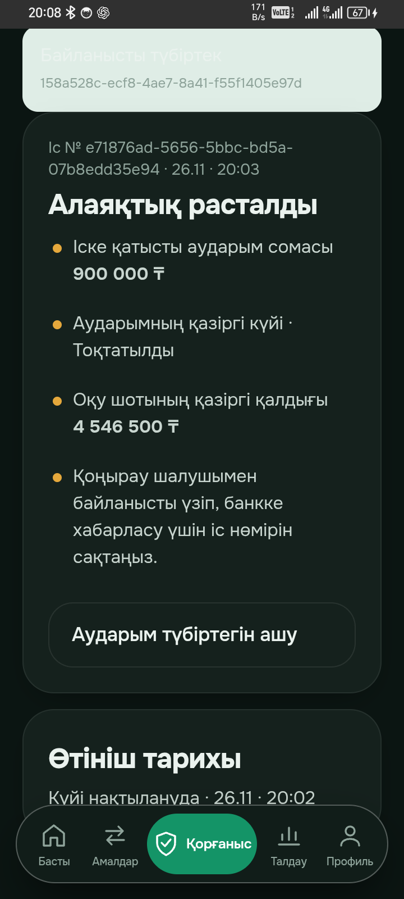

# Реальная проверка экосистемы Saq Bol — 26 ноября 2026

**PARTIAL: постоянный staging связан с физическим Android, настоящим Telegram и SOC. Публичный сайт/QR всё ещё относится к старому backend.** Проверенный code HEAD: `cee12aba7615ec1f09230b7586c464ad20249818`, [PR #37](https://github.com/foxfordkz-cyber/qadamxbcc/pull/37).

| Проверка | Результат | Фактические доказательства | Ошибка | Исправление |
|---|---|---|---|---|
| Honor X6 / VNE-LX1, 2.9 build 26 | PASS | Клиент вошёл; новая операция создана через UI физического телефона | USB сначала unauthorized | Пользователь разрешил USB; выбран конкретный serial |
| Android → HTTPS staging | PASS | Новая операция `158a528c-ecf8-4ae7-8a41-f55f1405e97d`, 900 000 ₸, Данияр А., COOLING_OFF | — | — |
| Telegram Guardian | PASS | Настоящее уведомление; ACK и SUSPICION_REPORTED записаны раздельно | Старый Fake-контакт ранее перехватывал advisory | Allowlist-aware выбор контакта, fix cee12ab и регрессии |
| PostgreSQL → SOC | PASS | Ровно один кейс `e71876ad-5656-5bbc-bd5a-07b8edd35e94`, тот же transfer ID | — | — |
| SOC → Android | PASS | Разрешённое SOC API-решение confirmed_fraud; реальная квитанция и баланс на Honor | — | — |
| SOC ноутбука | PASS для просмотра | Владелец вошёл в staging; показаны тот же UUID/сумма/получатель, причины, кейс v2 и журнал | Сначала открыт старый mobile; защищённое поле автоматически читалось маскированным | Открыт staging, пароль введён владельцем лично |
| Решение кнопкой браузера для вечернего кейса | NOT TESTED | При браузерной проверке кейс уже закрыт SOC API; терминальный UI не предлагает действий | Не переоткрывали искусственно ради теста | Для непрерывного дубля решение принимать сразу в веб-SOC |
| Деньги / idempotency | PASS | Баланс до/после 4 546 500.00 ₸; точный оригинальный запрос возвращает тот же UUID; один transfer/case/notice | — | — |
| Отмена на телефоне | PASS | Клиент нажал отмену; cancelled; деньги не списаны | — | — |
| Три серверные роли | PASS | Настоящие client/admin/platform login; запреты 403, неверный пароль 401 | — | — |
| Три роли Android | PASS | Клиент, SOC и Platform реально открыты на Honor, скриншоты | — | — |
| Возврат к клиенту и восстановление сессии после вечерней смены ролей | NOT TESTED | Последняя проверенная роль — platform_admin; затем пользователь открыл другое приложение | Автоматизация остановлена, чужой экран не затронут | [Свежий device evidence](evidence/final-release-20261126/evening-device.json); ранняя приёмка сессии учитывается отдельно |
| Краткое отключение сети физического телефона | NOT TESTED | Вечером связь всего телефона не переключалась | Нет свежего физического прогона | Отдельная проверка на свободном устройстве |
| Два Render restart | PASS ранее сегодня | Сохранены UUID, история, баланс, SOC и сессии | Не новый тест после вечернего live | Новые данные отдельно восстановлены из полной копии |
| Новый backup/restore | PASS | 25 таблиц, 8 373 строки; все строки и схема равны | — | Старые restore-базы сохранены, временный /32 удалён |
| Сайт / APK | PARTIAL | Реальное скачивание build 24 / старый backend; build 26 в отдельном private GitHub prerelease | Публичного cutover нет | Каналы явно разделены; старые данные не затронуты |
| Автотесты | PASS с SKIP | 339 уникальных PASS, 1 SKIP, новый вечерний прогон | PostgreSQL fixture локального раннера не настроен | Публичный PostgreSQL проверен отдельно |
| GitHub Actions | BLOCKED | Billing/spending-limit отказ | Ограничение аккаунта, не assertion | Нужен владелец billing; checks не отключались |
| Два физических телефона / непрерывное видео | NOT TESTED | Физический Honor + настоящий Telegram Web на ноутбуке | Второй Telegram-телефон не использован | Команде записать непрерывный дубль |

## Параметры нового теста

- Телефон: Honor X6 / VNE-LX1, `kz.qadamx.bccshield.demo`, 2.9 build 26.
- Backend: <https://saq-bol-mobile-staging.onrender.com>.
- SOC: <https://saq-bol-mobile-staging.onrender.com/soc/>.
- Transaction: `158a528c-ecf8-4ae7-8a41-f55f1405e97d`.
- Case: `e71876ad-5656-5bbc-bd5a-07b8edd35e94`.
- Сумма: 900 000 ₸; баланс до/после 4 546 500.00 ₸; итог cancelled.
- Отдельный bot: `saq_bol_staging_bekzat_bot`; новое ограниченное согласие, три служебных сообщения, штатный отзыв после проверки.
- PostgreSQL: `saq_bol_staging`, ограниченный SQL-пользователь, TLS, Alembic 0016_dispute_history; Valkey DB 12.
- Публичный сайт: старый `saq-bol-mobile`; candidate и staging SOC — один постоянный сервер. Jury отдельно.

## Доказательства и границы

[Полная финальная приёмка](FINAL_RELEASE_ACCEPTANCE_2026_11_26_RU.md), [Telegram audit](evidence/final-release-20261126/telegram-session-3-progress.json), [SOC/client result](evidence/final-release-20261126/live-soc-session3.json), [DB и replay](evidence/final-release-20261126/live-postgres.json), [backup/restore](evidence/final-release-20261126/backup-after-guardian.json), [339 тестов](evidence/final-release-20261126/evening-tests.json), [реальные публичные маршруты](evidence/final-release-20261126/public-routing.json).

Это результат новой операции телефона, не заранее записанный тур. Начальное решение сотрудника выполнялось защищённым API, поэтому скриншот не доказывает нажатие кнопки решения в веб-SOC. Главный backend, основная bcc_shield, старый mobile, main и публичный релиз не изменялись. Дизайн Айданы сохранён. Точное восстановление клиентской сессии после выхода/смены ролей отмечается отдельным свежим device evidence; прежние проверки не выдаются за вечерние.
