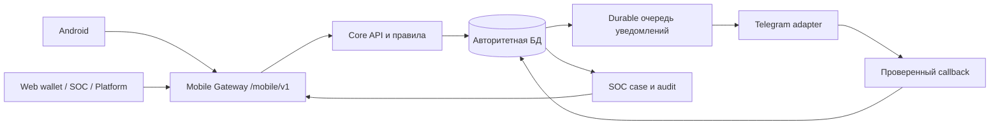

# Единая экосистема Saq Bol

Дата проверки: 25 ноября 2026. Ветка `integration/unified-ecosystem`, без merge в main.

## Источник состояния

Android Capacitor/WebView и серверный `/wallet/` используют один `Gateway` из
`android-app/www/gateway.mjs`. SOC — тот же клиент с серверной ролью `admin`;
`platform_admin` управляет доступом и техническими метриками, не финансовыми делами.
Мобильный FastAPI-шлюз вызывает существующий core и использует его SQLAlchemy-модели.
Новый ledger, broker и независимая система пользователей не создавались.

Статус и деньги определяет сервер. Guardian передаёт advisory-сигнал; он не
распоряжается средствами. Истечение таймера телефона не исполняет перевод.
Transaction ID сохраняется в квитанции, SOC и событиях; case ID обозначает конкретное
расследование. Не каждый временно удержанный перевод автоматически является мошенничеством.

## Окружения: не смешивать

| Окружение | Данные и назначение |
|---|---|
| `saq-bol-mobile.onrender.com` | Общий учебный backend Android, `/wallet/`, `/soc/`; три серверные роли |
| `saq-bol-jury.onrender.com` | Отдельные комнаты жюри, собственные синтетические операции; не ledger телефона |
| Публичный Cloudflare Worker | Страница продукта, тур, APK и ссылки на кабинеты; его core/BFF не объявляется синхронизированным с mobile |
| Локальная integration-проверка | Изолированные SQLite/fakeredis либо отдельные PostgreSQL/Redis контейнеры; не публичные данные |

`frontend/src/lib/connected-wallet.json` задаёт опубликованные API origin и ссылки
кабинетов. Gradle берёт default origin оттуда; `QADAM_API_ORIGIN` остаётся явным
инженерным override при сборке с проверкой HTTPS. Пользователь адрес не вводит.
Нативный bridge передаёт только настроенный origin. Пароли не находятся в этом JSON.
Сайт `/soc` теперь открывает SOC мобильного ledger, а не отдельную комнату жюри.

## Хранилище и предел готовности

Действующий публичный mobile сообщил `ephemeral_store=true`. `scripts/mobile_ephemeral.py`
поднимает временное хранилище; наличие PostgreSQL у другого сервиса команды не делает
его базой этого процесса. Нельзя перезапускать этот сервис ради применения новых
исходников до согласованного полноценного backup/restore. Публичная сохранность — NO-GO.

Подготовленный `scripts/rehearse_release_storage.py` создаёт только собственные
контейнеры, применяет миграции, делает полный PostgreSQL dump/restore и проверяет два
рестарта API. Это проверка механизма, не резервная копия текущего Render.
Redis не является долговременным источником финансовой истории; durable очередь и
состояние операций сохраняются в SQL. Перед миграцией нужны доступ к фактической БД,
полная резервная копия вне контейнера и проверенное восстановление.

## Новые модули

Переиспользовать существующие `app/integrations/telegram/adapter.py` и gateway-модуль,
а не создавать второго бота. Новый провайдер реализует существующий интерфейс адаптера
и тестируется на отказе, неизвестном результате доставки, повторе и истечении срока.
Будущий push должен читать зафиксированное событие через durable очередь; интерфейс
доставки не получает право исполнять финансовую операцию. Новый frontend подключается
к Gateway/OpenAPI и серверной роли, а не к SQL и не к Bot API напрямую.
