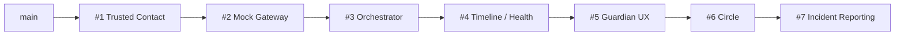

# Bekzat — GitHub attribution audit

19 November addendum: [PR #16](https://github.com/foxfordkz-cyber/qadamxbcc/pull/16)
contains real Private Scam Check/QA work. GitHub maps implementation `9037ea6` and
readiness/verification fix `342c0e5` to author **and** committer `bekzatwr`. No authorship
rewrites or merge into main were performed. [Delivery evidence](../guardian/PRIVATE_SCAM_CHECK_VERIFICATION.md).
The counts below are the dated 15 November snapshot, not current lifetime totals.

Дата проверки: 15 ноября 2026. Снимок **до публикации этого отчёта**:
main `a02d20dcc857001de364e0b0f12a66ce72db0c12`, PR #7
`7d8791f1d8c07de9ec1cd81b64b055daab5a536c`.
Адреса email намеренно не включены ни в отчёт, ни в JSON evidence.

## 1. Причина отсутствия в Contributors

**34 уникальных commit с author.login=bekzatwr; 0 в main; 34 вне main.**
Все семь PR ещё открыты и не merged. Default branch — main. GitHub корректно связывает
author и committer каждого из этих 34 commit с bekzatwr. Переписывать авторство или
менять email ради статистики не требуется. Код пока не включён в default branch.

Из 34 commit: **23 обычных непустых и 11 merge-коммитов**. GitHub Contributors graph
исключает merge/empty commits; 34 — размер уникальной авторской истории, а не обещанное
число в графе. После разрешённого включения всей этой истории в main базовый набор
подходящих обычных коммитов составляет 23. Дальнейшие содержательные commits считаются
отдельно. Источник: [GitHub — Viewing contributors](https://docs.github.com/en/repositories/viewing-activity-and-data-for-your-repository/viewing-a-projects-contributors).

В снимке всего 48 уникальных commit на remote refs: 13 в main принадлежат другому
автору; 34 принадлежат bekzatwr; один на отдельной frontend-ветке связан с codex.
Нельзя складывать полную историю каждой stacked-ветки: общие SHA будут посчитаны повторно.
Подсчёт выполнен по объединению SHA и серверной связи GitHub, не только по строке имени.

## 2. PR, функции и проверенные вершины

| PR | HEAD | Новых SHA относительно его base | Реальная функция | CI на этом HEAD |
|---|---|---:|---|---|
| [#1](https://github.com/foxfordkz-cyber/qadamxbcc/pull/1) | `59550de` | 5 | Telegram Trusted Contact / durable Retry-After | [PASS](https://github.com/foxfordkz-cyber/qadamxbcc/actions/runs/43563302792) |
| [#2](https://github.com/foxfordkz-cyber/qadamxbcc/pull/2) | `be7489d` | 7 | Mock Gateway | [PASS](https://github.com/foxfordkz-cyber/qadamxbcc/actions/runs/43563495541) |
| [#3](https://github.com/foxfordkz-cyber/qadamxbcc/pull/3) | `4533b16` | 13 | Integration Orchestrator / SOC / handoff | [PASS](https://github.com/foxfordkz-cyber/qadamxbcc/actions/runs/43563561759) |
| [#4](https://github.com/foxfordkz-cyber/qadamxbcc/pull/4) | `7f47709` | 4 | Incident Timeline / Integration Health | [PASS](https://github.com/foxfordkz-cyber/qadamxbcc/actions/runs/43567054363) |
| [#5](https://github.com/foxfordkz-cyber/qadamxbcc/pull/5) | `4b4826a` | 1 | Guardian RU/KK UX / Scam Check | [PASS](https://github.com/foxfordkz-cyber/qadamxbcc/actions/runs/43569413419) |
| [#6](https://github.com/foxfordkz-cyber/qadamxbcc/pull/6) | `8f98ad9` | 2 | Trusted Circle / preferences | [PASS](https://github.com/foxfordkz-cyber/qadamxbcc/actions/runs/43571963009) |
| [#7](https://github.com/foxfordkz-cyber/qadamxbcc/pull/7) | `7d8791f` | 2 | Incident Reporting / SOC summary / safe fake queue drain | [PASS](https://github.com/foxfordkz-cyber/qadamxbcc/actions/runs/43699812500) |

На момент снимка новых PR после #7 нет; все семь имели статус Draft и 0 reviews.
Этот отчёт добавляется содержательным documentation commit в существующий PR #7,
без отдельного PR ради счётчика. Он добавит один обычный commit к снимку:
35 уникальных / 24 обычных / 11 merge, по-прежнему 0 в main до разрешённого merge.
Его SHA и CI проверяются после публикации; это не часть исходного снимка 34.
Последующая Guardian 3.0 имеет отдельный contribution ledger и feature-ветки.

## 3. Author, committer и email

- Проверены серверные author.login и committer.login для всех 48 доступных SHA.
- Для всех 34 Bekzat SHA оба значения — bekzatwr; локальные author и committer совпадают.
- Используется один **не-noreply** адрес, уже связанный GitHub с аккаунтом. Значение скрыто.
- Локальная настройка будущих commits совпадает с этим адресом; она не изменялась.
- Приватный флаг email.verified не подтверждён: доступный credential получил HTTP 404
  на /user/emails. Это ограничение доступа, а не доказательство неверного адреса.
  Серверная связь всех commits с bekzatwr подтверждена независимо.
- Авторство других участников и co-author trailers не изменялись. В main найдены
  11 существующих co-author trailers другого участника; они не считаются вкладом Bekzat.

## 4. Целостность истории и совместимость

Все 34 SHA достижимы из PR #7. Для каждой пары base→head base является предком head,
а актуальный main является предком всех семи heads. `git merge-tree --write-tree`
проверил каждую пару без конфликтов; результирующее дерево равно дереву соответствующего
head. Коммиты merge при проверке не создавались, refs не менялись.

Пустых обычных авторских commits и групп одинаковых stable patch-id не обнаружено.
Это подтверждает отсутствие потерянных SHA/повторно применённых идентичных patch в
проверенной истории, но не заменяет семантический code review всех строк.
Ветка `feat/mobile-client-cooling-flow` (`e7f84c9`) связана с codex, не входит в эту
цепочку и не присваивается Bekzat. Её изменения не перезаписываются.

На текущих heads повторно проверены CI metadata: verify и Docker E2E успешны у всех PR.
Последний общий набор: 234 уникальных backend-теста (224 portable passes + 10 external-only
skips, все 186 PostgreSQL/Redis integration cases проходят отдельно), 12 frontend-тестов,
Ruff, strict mypy, tsc/build и verify.sh. Не складывать пересекающиеся прогоны.
Экспорт OpenAPI и 22 JSON examples сверяются тестами с приложением. Существующие
evaluate/resolve-cooling контракты, scoring и frontend не переписаны.
SQLite/PG upgrade/downgrade и ORM parity подтверждены в [Guardian verification](../guardian/VERIFICATION.md).
Новых runtime/migration изменений этот attribution commit не содержит; CI его нового
head выполняется отдельно. Старые результаты не выданы за запуск изменённого кода.

## 5. Required checks, review и права

REST: allow_merge_commit=true, allow_squash_merge=true, allow_rebase_merge=true;
auto-merge=false, auto-delete branch=false. Возможность merge commit разрешена настройкой,
но выбор стратегии и сам merge ещё требуют отдельного согласования владельца.

main protected=false; активные branch rules и repository rulesets пусты. Protection API
вернул 404, что согласуется с этим состоянием. Следовательно **сервером сейчас не
навязаны required checks или обязательное количество approvals**. Зелёный CI не является
разрешением владельца. У текущего доступа push есть, admin/maintain нет; политика
репозитория не изменялась. Рекомендуемые release gates: verify + compose-demo + review
владельца core/миграций + совместная frontend-приёмка.

## 6. Порядок включения без потери авторства

Граф показывает **зависимости**, не уже выполненные merge.

1. Владелец review-ит #1 и отдельно разрешает merge commit в main. Перепроверить точный
   HEAD, CI и отсутствие новых изменений main непосредственно перед merge.
2. После успешного #1 **переназначить base #2 на main**. Сейчас его base — feature-ветка
   #1: обычный merge #2 в её текущую base НЕ включил бы код непосредственно в main.
3. Перепроверить diff, CI и review после retarget; только после разрешения владельца
   выполнить merge commit #2→main. Аналогично #3, #4, #5, #6, #7 — строго по порядку.
4. Сохранять feature-ветки до проверки всей цепочки; auto-delete выключен. Не squash,
   не rebase merge, не cherry-pick для замены исходных SHA, не force push и не amend author.
5. При новых изменениях main перепроверить конфликты/контракты/миграции. При необходимости
   согласовать включение main обычным merge в feature, сохраняя авторство обоих родителей.

Каждый PR технически готов к owner review на текущем снимке; #2–7 безопасны только
после своих зависимостей. Финальный runtime требует целой migration graph до 0006.
Старые workers необходимо остановить перед применением новых contact preferences.
Автоматическое включение кода или изменение main этим аудитом не выполняется.

## 7. Проверка после отдельно разрешённого merge — пока NOT RUN

Для каждого SHA из BEKZAT_ATTRIBUTION_EVIDENCE.json выполнить после fetch:
`git merge-base --is-ancestor <sha> origin/main`; код возврата должен быть 0.
Сравнить исходные SHA, author/committer mapping и отсутствие переписанной истории.
Проверить новый default-branch HEAD, Contributors graph и REST /stats/contributors.

Статистика GitHub кэшируется по SHA default branch; после изменения main может
пересчитываться асинхронно, и REST может вернуть 202. Проверять повторно после паузы,
не создавать фиктивный commit и не переписывать историю ради сброса кэша.
[GitHub — repository statistics](https://docs.github.com/en/rest/metrics/statistics#about-repository-statistics).
Не обещается мгновенное появление или точное время обновления. Если после пересчёта
записей нет, проверить association, default branch и период графа; при длительной
задержке владелец может обратиться в GitHub Support. Сейчас ждать кэш бессмысленно:
первичная причина — ноль Bekzat commits в main, а не подтверждённый сбой статистики.

## 8. Что ещё требуется

Отдельное разрешение владельца на merge и стратегию merge commit; review текущих
heads и миграций; совместная frontend/SOC-приёмка. Подтверждение SMTP email недоступно
данному credential, но обнаруженной ошибки attribution нет и изменение адреса не требуется.
До разрешённого merge Contributors для нового вклада объективно не исправлен.
Подготовка и проверка завершены в разрешённой области; авторство и main сохранены.
